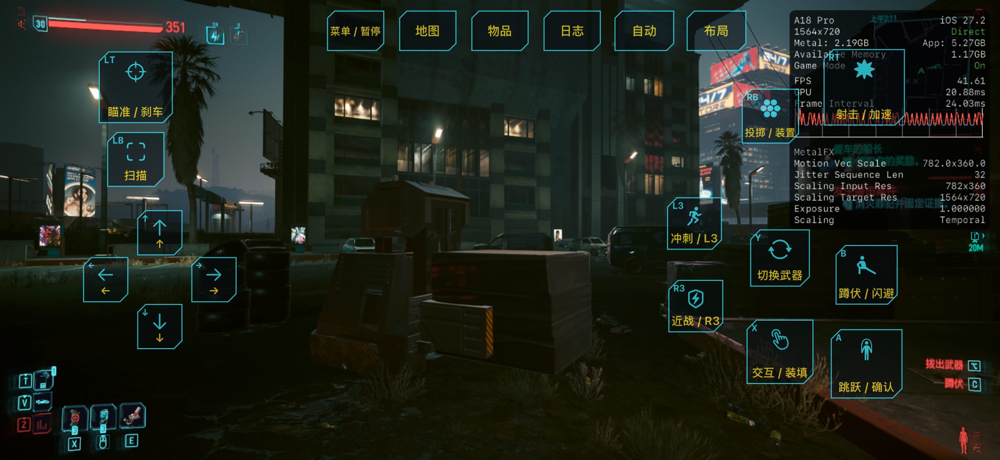
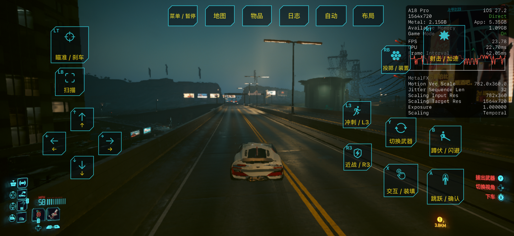
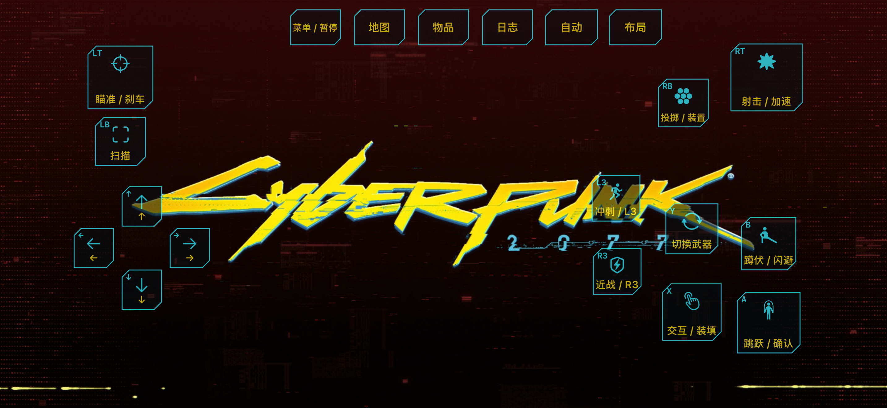
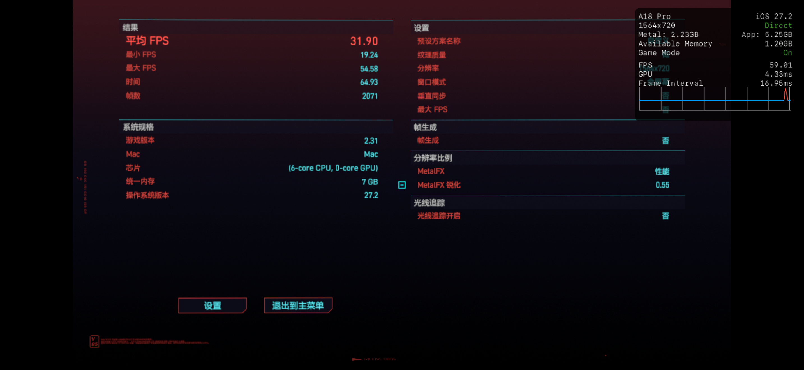

# Cyberpunk 2077 iOS Launcher

适用于 iPhone 和 iPad 的 Cyberpunk 2077 启动器，支持 720p / 1080p 输出、触控和实体手柄。

- 当前版本：0.8.1 / build 11
- 系统要求：iOS / iPadOS 18 或以上
- 游戏文件：Steam macOS 2.31 ARM64 版，需要自行准备

[下载 IPA 和工具](https://github.com/dingelero/cyberpunk2077-ios-launcher/releases/latest) · [完整安装教程（中文 / English）](docs/DingElero启动器-使用教程.md)

## 游戏截图

**实机游戏画面**



**驾驶画面**



**触控界面**



**游戏内基准测试（帧生成关闭）**



## 安装与导入资源

1. 重签 IPA 及其嵌套动态库后安装。覆盖更新保持原 Bundle ID，保留资源和存档。
2. 打开一次启动器，创建 `GuestGame` 文件夹。
3. 在“文件”App 中，将游戏目录里的 `archive`、`engine`、`r6` 和 `Cyberpunk2077.app` 完整解压后，直接放入：

   **浏览 → 我的 iPhone / iPad → 赛博朋克2077 → GuestGame**

   如果签名工具修改了应用名称，以实际名称为准。
4. 等待复制完成，回到启动器，选择设备预设和分辨率，再开始游戏。

```text
GuestGame/
├─ archive/Mac/…
├─ engine/…
├─ r6/cache/tweakdb.bin
└─ Cyberpunk2077.app/Contents/…
```

保留全部子目录，不要多套一层 `Cyberpunk 2077`，不要直接放入压缩包。资源约 70 GB（本体）或 96 GB（全部），另留运行空间。IPA 不包含这些大型资源。

## 操作

左半屏空白处按下使用浮动摇杆，右半屏滑动转动视角。支持多点触控和实体手柄。“布局”可调整按键、大小、透明度和镜头灵敏度；约 4 秒无触摸后隐藏按钮。启动页可切换中文和 English。

各设备的兼容性、持续性能和 HDR 支持情况仍需真机测试。反馈时请提供机型、系统版本、设备预设和出现问题的场景；日志位于应用文件夹的 `GuestGame` 上一级。

## 构建

需要 Apple Silicon Mac、Xcode 27 beta / iPhoneOS 27 SDK、Python 3.11+ 和匹配版本的游戏文件。

```sh
cp config.example.json config.local.json
# 在 config.local.json 中设置 game_root 和 developer_dir
python3 tools/build_all.py --platform ios --output dist/Cyberpunk2077-DingElero-universal-v5.ipa
```

## 第三方代码

兼容层参考 [Stray-iOS](https://github.com/xzk49/Stray-iOS)。第三方许可见 [说明文件](THIRD_PARTY_NOTICES.txt)、[Stray-iOS](LICENSE-Stray-iOS.txt)、[curl](curl-COPYING.txt) 和 [OpenSSL](openssl-LICENSE.txt)。
